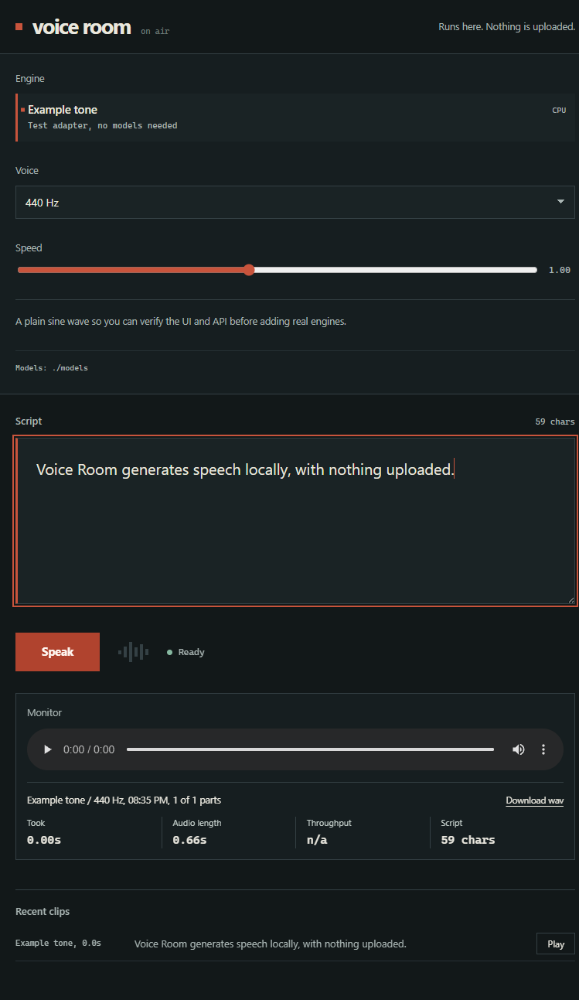

# Voice Room

---

<p align="center">
  
</p>

<p align="center"><strong>Local text to speech. Runs here. Nothing is uploaded.</strong></p>

<p align="center">
  github.com/Raghav2012Code/voice-room: the source, docs and releases. Liked Voice Room?
  <a href="https://github.com/Raghav2012Code/voice-room/stargazers">Star it there</a>, one to five clicks.
</p>

<p align="center">
  <a href="#run-it"></a>
  <a href="#native-windows-app"></a>
  <a href="docs/ADDING_AN_ENGINE.md"></a>
</p>

Windows 10 and 11 (x64) native app. Browser UI on Windows, Linux and macOS. Python 3.10 or newer. 87 languages is not a claim we make, but adding any local engine is. No ads, no trial, no sign-up.

|  |  |  |  |
| :---: | :---: | :---: | :---: |
| **Local only** | **Any engine** | **No length cap** | **Open** |
| **0 bytes** uploaded | **1 file** to add an engine | **Unlimited** text length | **MIT** license |
| Text and audio stay on your PC | Drop an adapter into `server/engines/` | Sentence chunking, live playback, Stop | Source, config and docs in the repo |

## Voice Room



Type a script, pick an engine and a voice, press Speak. Long text is split into sentence-sized parts, each part plays as it finishes, and the whole take can be downloaded as one WAV. Generation time, audio length and throughput appear in the Monitor.

## Why switch from a cloud TTS tab?

Same idea you know, but the speech is made on your own machine. No per-character bill and no account.

| **Phonon, CPU** | **Kokoro, CPU** | **Chatterbox, GPU** |
| :---: | :---: | :---: |
| **0.32 RTF** | **0.80 to 1.07 RTF** | **1.09 RTF** |
| about 3x realtime | near realtime | near realtime on a 4 GB card |

Measured on the developer's machine: i5-11400F, 16 GB DDR4-2133, RX 6500 XT 4 GB. RTF is generation seconds divided by audio seconds, so lower is faster. Your results will depend on hardware, model and text. These are observations, not guarantees.

| | Voice Room | Typical cloud TTS tab |
| --- | --- | --- |
| Where speech is made | **On your PC** | Vendor servers |
| Text leaves your machine | **No** | Yes |
| Works offline | **Yes, with local models** | No |
| Bring your own model | **One adapter file** | Not supported |
| Cost | **Free, MIT license** | Often per character |
| Account or API key | **None** | Usually required |
| Long text | **Chunked, no cap** | Often capped |
| Desktop window | **Native app on Windows** | Browser tab |

Nothing new to learn: the console, the engine rail, the voice picker, the Monitor and the download button are all in one window.

## Run it

```sh
python -m server.server
```

Open `http://127.0.0.1:8766/`. The shipped `config.example.json` enables a sine-wave example engine, so you can try the whole flow with no models installed.

To use your own engines:

```sh
cp config.example.json config.json
```

Edit `config.json`: set `models_dir`, enable the adapters you have, and point each one at its files. `config.json` is gitignored and stays on your machine.

Optional adapter dependencies:

```sh
pip install -r requirements-adapters.txt
```

## Add an engine

Engines are plain Python files in `server/engines/`. The UI builds itself from `GET /api/engines`, so there are no HTML or JavaScript edits. An adapter provides `available()`, `voices()` and `synthesize(text, voice, speed, out_path)`, plus a few metadata strings. See [docs/ADDING_AN_ENGINE.md](docs/ADDING_AN_ENGINE.md) for the full contract and a walkthrough.

Included adapters:

| Adapter | Needs | Notes |
| --- | --- | --- |
| example | nothing | Sine wave, useful for verification |
| phonon | standalone `ptts` CLI and model | Fast CPU engine, many voices |
| kokoro | `kokoro-onnx`, numpy, soundfile and ONNX files | 54 voices, several languages |
| kitten | `kittenml`, soundfile and model folder | Small English voice set |
| chatterbox | external HTTP or Vulkan server | Voice tags and cloning, GPU |

## Native Windows app

The `desktop/` folder is a Tauri v2 shell. It starts the configured backend, waits for the port, opens a native window and stops the backend when you close the window.

```sh
cd desktop
npm install
npx tauri build
```

Put a `config.json` next to the built executable, or set `VOICE_ROOM_CONFIG`, with absolute paths to your Python interpreter and this repo:

```json
{
  "server": {
    "command": ["C:/path/to/venv/Scripts/python.exe", "-m", "server.server"],
    "cwd": "C:/path/to/voice-room",
    "port": 8766,
    "log": "C:/path/to/voice-room/server.log"
  }
}
```

The window loads `http://127.0.0.1:<port>/`. Keep port 8766 unless you also change the window URL in `desktop/tauri.conf.json`.

## API

- `GET /api/health`: status, model root and loaded engine ids
- `GET /api/engines`: engines, voices and capabilities (`/api/voices` is an alias)
- `POST /api/speak`: JSON `{ "engine", "text", "voice", "speed" }`, returns raw WAV with `X-Gen-Seconds`, `X-Audio-Seconds` and `X-Sample-Rate` headers

## Tests

```sh
python -m unittest discover -s tests -v
```

Six tests use the dependency-free example adapter, so no TTS models are needed. GitHub Actions runs the same command on every push.

## Privacy

The server binds to `127.0.0.1` by default. Text and audio stay on your machine. No telemetry, no accounts, no API keys.

## License

MIT. See [LICENSE](LICENSE).
