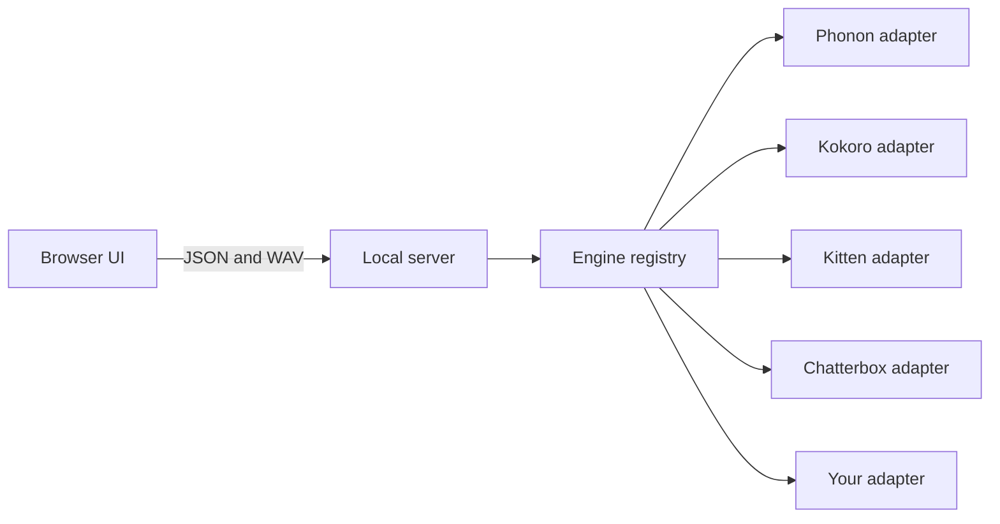

import useBaseUrl from '@docusaurus/useBaseUrl';

# Voice Room

Voice Room is a local text to speech studio. You type a script, choose an engine and a voice, press Speak, and the audio is generated on your own machine. Nothing is uploaded, and there is no account or API key.

## What you get

- A dark broadcast console with an engine rail, voice picker, speed control, live status, generation stats and WAV download.
- Long scripts split into sentence sized parts, played as each part finishes, with Stop and one merged WAV.
- A small local HTTP server and a UI that reads its engines from the server, so adding a model does not mean editing the page.
- An optional Tauri v2 desktop shell for Windows that starts and stops the backend for you.
- MIT licensed source, tests and a dependency free example engine.

## How it fits together

The server binds to `127.0.0.1` by default. The UI is static HTML, CSS and JavaScript. Engines are small Python adapters in `server/engines/` that write a WAV file.

## Where to go next

- [Quickstart](/docs/quickstart): run the server and hear the example engine in under a minute.
- [Engines](/docs/engines/overview): what is included and how discovery works.
- [Add an engine](/docs/engines/adding-an-engine): the adapter contract and a walkthrough.
- [Configuration](/docs/configuration): every config key in one place.
- [API reference](/docs/api): the three endpoints and their headers.
